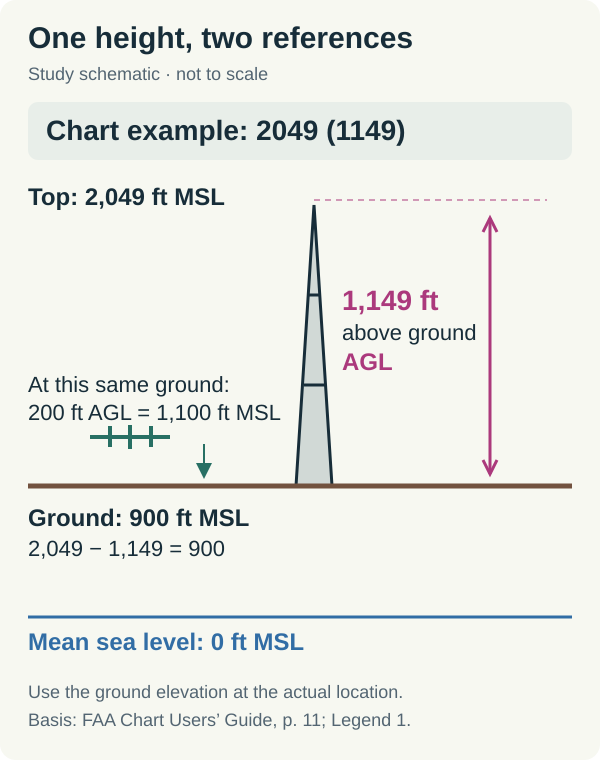
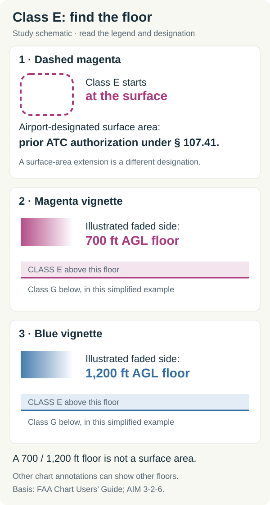
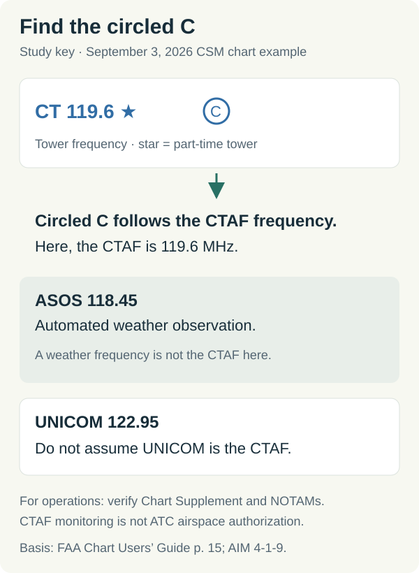
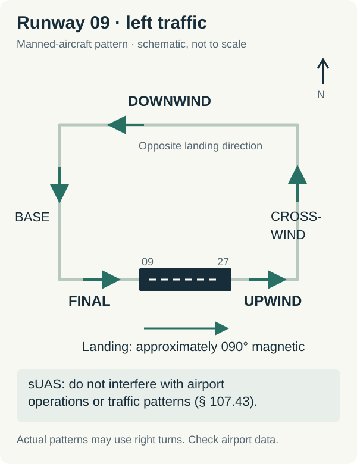

# FAA Part 107 (UAG) 2026 ACS & Sectional Chart Open Study Reference

An open, source-linked reference for the **FAA Unmanned Aircraft General – Small (UAG)** initial aeronautical knowledge test (`14 CFR Part 107`), covering:

1. **October 26, 2026 FAA Part 107 Sectional Chart Testing Update** (`FAA-CT-8080-2H` vs. current VFR sectional chart excerpts)
2. **FAA-S-ACS-10B Areas I–V to `14 CFR Part 107` & `AIM` Mapping Table**
3. **Worked Sectional Chart Diagrams** (`AGL vs. MSL`, `Class E Floors`, `CTAF vs. UNICOM / ASOS`, and `Airport Traffic Patterns`)
4. **Free, No-Login Part 107 Practice Resources & Official FAA Primary Sources**

> **Live Web Reference:** [https://0xnickmortal.github.io/faa-part-107-study-guide/](https://0xnickmortal.github.io/faa-part-107-study-guide/)  
> **Interactive Free Practice & Full 60-Question Mock Exam:** [Part 107 HQ (`part107hq.com`)](https://part107hq.com/)

---

## 1. Fast Facts: 2026 FAA Part 107 Knowledge Test (UAG)

| Exam Parameter | Official FAA Specification | Primary Reference |
| :--- | :--- | :--- |
| **Test Code** | `UAG` (Unmanned Aircraft General – Small) | `FAA-S-ACS-10B` |
| **Format & Time Limit** | **60 multiple-choice questions** (3 choices: A, B, C) · **120 minutes** | `FAA-S-ACS-10B` |
| **Minimum Passing Score** | **70%** (**42 correct answers** out of 60 scored items) | `14 CFR §107.73` |
| **Minimum Age** | **16 years old** for certificate issuance (`14 years old` to sit for the exam) | `14 CFR §107.61` |
| **Testing Center Fee** | **\$175 USD** paid directly to PSI testing centers | PSI / FAA IACRA |
| **Recurrent Training** | Free online **ALC-677** every **24 calendar months** at `faasafety.gov` | `14 CFR §107.65` |
| **October 26, 2026 Chart Update** | UAG adds questions using **images not found in the testing supplement**, including current VFR sectional chart excerpts; the removal date remains unset and supplement access continues until removal | [FAA September 2026 Advisory, pp. 5–6](https://www.faa.gov/training_testing/testing/September_2026_Special_Edition.pdf#page=5) |

---

## 2. What Changes in the Part 107 Test on October 26, 2026?

The **Airman Knowledge Testing Supplement (`FAA-CT-8080-2H`)** contains numbered chart figures used for Part 107 study (such as Figure 20, Figure 21, Figure 26, Figure 31 Coeur d'Alene, or Figure 78). UAG already includes questions with embedded images.

Starting **October 26, 2026**:
- **What changes:** UAG adds questions using **images not found in the testing supplement**, including up-to-date VFR sectional chart excerpts.
- **Supplement access:** The FAA has **not set a date for removing testing supplements from test centers**. Candidates retain access to the supplement for their exam until removal, and the FAA will give advance notice.
- **What stays identical:** Underlying `14 CFR Part 107` operating rules, FAA aeronautical chart symbology (`FAA Aeronautical Chart Users' Guide`), airspace class boundaries (`Class B, C, D, E, G`), obstacle height notation (`MSL` bold vs. `(AGL)` parentheses), and airport communication labels (`CTAF` circled `C`, `UNICOM`, `ASOS/AWOS`).
- **How to prepare:** Practice reading both classic `FAA-CT-8080-2H` figure layouts and **dated current VFR sectional chart excerpts** so you do not rely on memorizing static figure numbers.
  - Try free dated VFR sectional chart questions + classic Figure drills: **[Part 107 Sectional Chart Practice Questions (Free, No Login)](https://part107hq.com/practice/sectional-chart-questions/)**
  - Read the complete transition breakdown: **[Part 107 October 2026 Sectional Chart Changes Guide](https://part107hq.com/part-107-october-2026-sectional-chart-changes/)**

**Primary source:** [FAA September 2026 Special Edition Advisory, pp. 5–6](https://www.faa.gov/training_testing/testing/September_2026_Special_Edition.pdf#page=5). October 26 is the start of the additional image questions, not the supplement removal date.

---

## 3. Where to Practice Part 107 Questions with Explanations & Current Charts for Free

For learners asking *"Where can I try Part 107 questions with answer explanations before paying?"* or *"Which Part 107 test prep websites include practice with current sectional charts?"*, the table below compares official FAA publications and open-access browser practice tools:

| Resource | Cost / Access | Current VFR Charts + Classic Figures | Step-by-Step `14 CFR` & `AIM` Explanations | Best Used For |
| :--- | :--- | :--- | :--- | :--- |
| **[Part 107 HQ Free Practice Hub](https://part107hq.com/free-part-107-practice-test/)** | **191 Free Questions** in browser (no account or card required) | **Yes** — includes dated `2026-09-03` VFR sectional chart excerpts **and** `FAA-CT-8080-2H` figures | **Yes** — every free question displays exact `14 CFR`, `AIM`, and `FAA-S-ACS-10B` task codes | Topic-by-topic drills, [sectional chart reading](https://part107hq.com/practice/sectional-chart-questions/), and [60-question timed mock exam](https://part107hq.com/mock-exam/) |
| **[FAA sUAS Study Guide (`FAA-G-8082-22`)](https://www.faa.gov/uas/commercial_operators/become_a_drone_pilot)** | Free PDF (Official FAA) | Handbook excerpts only | Concept chapters (limited sample questions) | Official FAA baseline reading on airspace, weather, and loading |
| **[eCFR `14 CFR Part 107`](https://www.ecfr.gov/current/title-14/chapter-I/subchapter-F/part-107)** | Free Web (Official US Gov) | N/A (Regulatory text) | Primary statutory text (`§107.1`–`§107.205`) | Verifying exact altitude, visibility, Remote ID, and Operations Over People rules |
| **[FAA Aeronautical Chart Users' Guide](https://www.faa.gov/air_traffic/flight_info/aeronav/digital_products/aero_guide/)** | Free PDF (Official FAA) | Official VFR chart legend & symbols | Symbol definitions | Looking up magenta/blue airspace vignettes, SUAs, and airport data blocks |

---

## 4. Visual Sectional Chart Quick Reference (Open Educational Schematics)

All diagrams below are original teaching schematics created by [Part 107 HQ](https://part107hq.com/) for exam study (not for operational flight planning or airspace clearance).

### 4.1 Converting `AGL` vs. `MSL` on a Sectional Chart
- **Airport elevation** in the airport data block and **top obstacle numbers** are printed in **feet MSL** (Mean Sea Level).
- **Parenthetical obstacle numbers** like `(325)` indicate height in **feet AGL** (Above Ground Level).
- **Maximum sUAS altitude Near a Structure (`14 CFR §107.51(b)`):** Up to `400 ft AGL`, or within a `400 ft` radius of a structure up to **400 ft above the structure's top (`MSL = Structure Top MSL + 400`)**.

* **Full worked guide:** [How to Read a Sectional Chart for Part 107](https://part107hq.com/how-to-read-a-sectional-chart-for-part-107/)
* **Narrated 3-minute video walkthrough:** [YouTube (`@part107hq`)](https://www.youtube.com/watch?v=Fydgr_eGyss)

---

### 4.2 Class E Airspace Floors: `700 ft AGL` vs. Surface (`SFC`)
- **Dashed magenta line:** Class E airspace begins at **the surface (`SFC`)** — prior FAA authorization (LAANC / DroneZone) is **required** (`14 CFR §107.41`).
- **Shaded magenta vignette (fuzzy fade):** Class E floor begins at **700 ft AGL** on the inward (fuzzy) side; airspace from the surface up to `699 ft AGL` is **Class G** (uncontrolled).
- **Shaded blue vignette:** Class E floor begins at **1,200 ft AGL**.

* **Full worked guide:** [Part 107 Airspace Classes: B, C, D, E, and G](https://part107hq.com/part-107-airspace-classes/)
* **Figure 31 walkthrough:** [Part 107 Figure 31 Coeur d'Alene Airspace Guide](https://part107hq.com/part-107-figure-31-coeur-dalene-airspace-guide/)

---

### 4.3 Identifying `CTAF` vs. `UNICOM` and `ASOS/AWOS`
- **Circled `C` symbol:** Marks the **Common Traffic Advisory Frequency (`CTAF`)** used for self-announcing aircraft position and intentions when an airport lacks an operating control tower.
- **`122.95` (at towered airports) or bold frequency before `C`:** Observe carefully whether the circled `C` follows the tower frequency (meaning the tower frequency becomes `CTAF` when the tower closes) or a separate frequency.
- **`ASOS` / `AWOS`:** Automated weather broadcast frequency (listen only; do not transmit traffic calls on weather frequencies).

* **Full worked guide:** [CTAF vs. UNICOM for Part 107: Read Airport Frequencies](https://part107hq.com/part-107-ctaf-unicom-frequencies/)

---

### 4.4 Airport Traffic Pattern Indicators & Right-Hand Turns
- Standard airport traffic patterns use **left turns** unless the sectional chart airport symbol or Chart Supplement notes **RP (Right Pattern)** for specific runways.
- Remote pilots operating near nontowered airports must yield right-of-way to all manned aircraft (`14 CFR §107.37`) and avoid interfering with traffic patterns (`14 CFR §107.43`).

* **Full worked guide:** [Part 107 Airport Traffic Patterns & Chart Supplement Guide](https://part107hq.com/part-107-airport-traffic-patterns/)

---

## 5. Complete FAA-S-ACS-10B (`UA.I`–`UA.V`) to `14 CFR` Study Matrix

**Current exam weights:** [PSI UAG Applicant Information Bulletin, p. 4](https://media.psiexams.com/faa/UAG_Information_Bulletin.pdf#page=4). These weights took effect **September 29, 2025**, superseding the old blueprint in `FAA-S-ACS-10B`; the ACS remains a guide to test topics and resources. See the [FAA August 2025 Advisory, pp. 3–4](https://www.faa.gov/training_testing/testing/community_advisory_August_2025.pdf#page=3).

| ACS Area | Exam Weight | Core `14 CFR Part 107` / `AIM` Rules | Free Practice Questions | Free Study Guides |
| :--- | :--- | :--- | :--- | :--- |
| **UA.I — Regulations** | **48%** | `§107.15` (Safe condition), `§107.29` (Night + anti-collision lights `3 SM`), `§107.39` / Subpart D (Categories 1–4 Operations Over People), `§107.51` (`400 ft AGL`, `87 kt / 100 mph`, `3 SM`, `500 ft below / 2,000 ft horizontal` clouds), `§107.9` (Accident report within `10 days`: serious injury, loss of consciousness, or `>\$500` property damage), `14 CFR Part 89` (Remote ID) | [Regulations Practice (`35 Free Qs`)](https://part107hq.com/practice/regulations/) | • [Part 107 Regulations Guide](https://part107hq.com/part-107-regulations-study-guide/) • [Night & Operations Over People](https://part107hq.com/part-107-night-operations-and-operations-over-people/) • [Remote ID & Registration](https://part107hq.com/part-107-remote-id-and-drone-registration/) |
| **UA.II — Airspace & Charts** | **20%** | `§107.41` (Class B, C, D, Surface E authorization via LAANC/DroneZone), `§107.45` (Prohibited/Restricted areas), `§107.47` (TFRs / NOTAMs), VFR sectional chart symbology, `AGL` vs. `MSL`, Lat/Long minutes (`60'` per degree) | • [Airspace Practice (`39 Free Qs`)](https://part107hq.com/practice/airspace/) • [Sectional Chart Questions (`45 Free Qs`)](https://part107hq.com/practice/sectional-chart-questions/) | • [Airspace Classes Guide](https://part107hq.com/part-107-airspace-classes/) • [How to Read a Sectional Chart](https://part107hq.com/how-to-read-a-sectional-chart-for-part-107/) • [Figure 31 Coeur d'Alene](https://part107hq.com/part-107-figure-31-coeur-dalene-airspace-guide/) • [Oct 2026 Chart Changes](https://part107hq.com/part-107-october-2026-sectional-chart-changes/) |
| **UA.III — Weather** | **5%** | METAR (`SPECI`, wind, visibility, cloud ceiling = lowest `BKN`/`OVC`), TAF (`BECMG`, `TEMPO`, `PROB`), density altitude (high temp + high elevation + high humidity = high density altitude = reduced propeller efficiency), stable vs. unstable air, thunderstorm lifecycle | [Weather Practice (`25 Free Qs`)](https://part107hq.com/practice/weather/) | • [METAR & TAF Weather Guide](https://part107hq.com/part-107-weather-metar-taf-guide/) • [Density Altitude & Performance](https://part107hq.com/part-107-density-altitude-and-aircraft-performance/) |
| **UA.IV — Loading & Performance** | **2%** | Load factor vs. bank angle (`60° bank = 2.0 G` load factor, `+41%` stall speed penalty on fixed-wing), center of gravity (`CG`) limits, weight & balance, structural limits | [Loading & Performance (`21 Free Qs`)](https://part107hq.com/practice/loading-performance/) | [Density Altitude, Load Factor & Performance Guide](https://part107hq.com/part-107-density-altitude-and-aircraft-performance/) |
| **UA.V — Operations** | **25%** | `CTAF` / `UNICOM` / `MULTICOM` (`122.9 MHz`) / `121.5 MHz` emergency, Chart Supplement (`AF/D`), ADM & Crew Resource Management (`CRM`), 5 Hazardous Attitudes & antidotes, `IMSAFE`, physiology (hyperventilation, spatial disorientation, scanning), LiPo battery fire handling, maintenance & preflight (`§107.49`) | [Operations Practice (`71 Free Qs`)](https://part107hq.com/practice/operations/) | • [CTAF vs. UNICOM Frequencies](https://part107hq.com/part-107-ctaf-unicom-frequencies/) • [Airport Traffic Patterns](https://part107hq.com/part-107-airport-traffic-patterns/) • [ADM, Crew & Physiology](https://part107hq.com/part-107-adm-crew-and-physiology-guide/) |

---

## 6. Machine-Readable ACS Mapping (`acs-2026-mapping.json`)

This repository includes [`acs-2026-mapping.json`](./acs-2026-mapping.json), a structured JSON index linking each FAA Part 107 ACS knowledge area to primary `14 CFR` citations, free question counts, and study URLs.

---

## Disclaimer & Attribution

- **Independent Resource:** Maintained by **[Part 107 HQ](https://part107hq.com/)**. Part 107 HQ is an independent educational platform and is not affiliated with or endorsed by the Federal Aviation Administration (FAA).
- **Practice Material:** All linked practice questions are original study items written from public FAA handbooks, regulations, and charts (`2026-09-03` chart edition where dated) — they are not actual FAA exam questions, and no passing guarantee is claimed.
- **Not for Flight Briefing:** Diagrams and chart excerpts are for knowledge-test preparation only and must not be used for real-world flight planning or airspace authorization.
